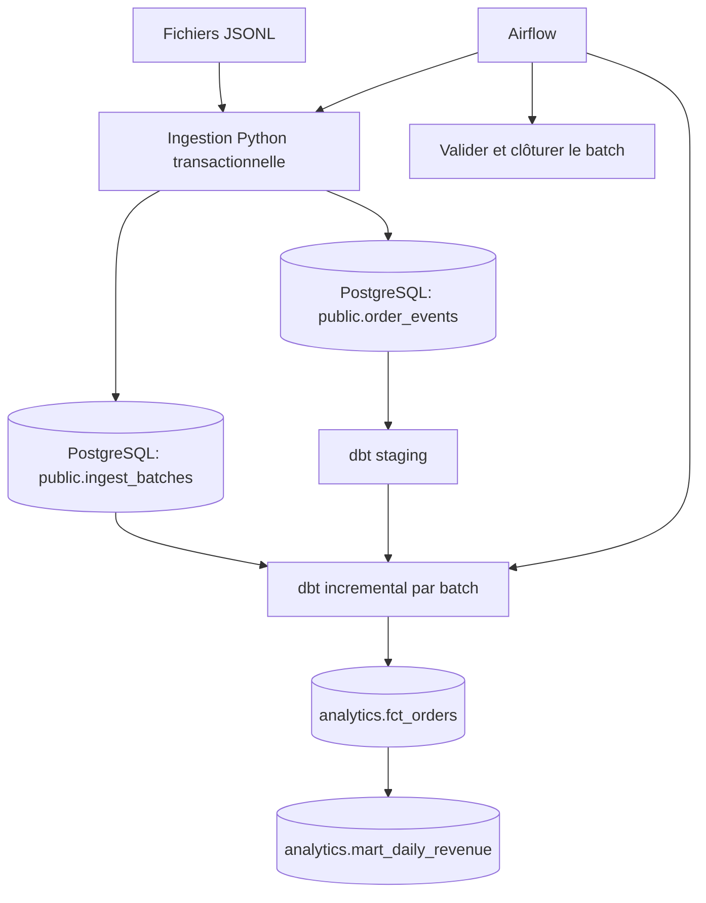

# Architecture et choix techniques

## Stratégie incrémentale
1. Chaque fichier reçoit un `batch_id` immuable avec empreinte SHA-256.
2. Pour chaque batch, dbt repère les `order_id` touchés.
3. Pour ces seules commandes, dbt relit **tous** les événements historiques.
4. `ROW_NUMBER` classe les versions par `event_ts DESC, event_id DESC`.
5. `MERGE` met à jour la table de faits par `order_id`.

Cela évite de perdre les événements arrivés en retard à cause d'un filtre simple sur le dernier timestamp d'ingestion. `event_ts` est ici une version métier : pour un vrai flux CDC, privilégier une version ou un numéro de séquence fiable.

La suppression est **logique** : `is_deleted = TRUE` reste dans `fct_orders` et disparaît de l'agrégat de chiffre d'affaires.

## Fiabilité

- Ingestion atomique (transaction PostgreSQL).
- `event_id` unique et empreinte de fichier pour empêcher un rejeu différent.
- `dbt build` exécute transformations et tests.
- Le batch n'est marqué `processed` qu'après réussite de dbt et vérification des versions.
- Airflow utilise `max_active_runs=1`.

## Limites réelles

- Projet local à exécuteur unique : des jobs concurrents hors DAG ne sont pas pris en charge.
- Pas de prise en charge des très gros volumes, d'un registre de schémas, ni de CDC distribué.
- Les dimensions clients et produits sont simples ; il ne s'agit pas d'un modèle SCD Type 2.
- Airflow s'exécute localement dans Docker avec une image personnalisée ; il ne s'agit pas d'un déploiement de production et aucun coffre à secrets n'est configuré.
- Les identifiants dans `docker-compose.yml` sont réservés au développement local.

## Captures utiles dans le README final

1. Graph Airflow (3 tâches vertes).
2. Logs `dbt build` avec tests réussis.
3. Requête SQL sur `analytics.fct_orders`, dont une ligne supprimée.
4. Résultat `analytics.mart_daily_revenue` : total 300,00 €.
5. Workflow GitHub Actions réussi.
